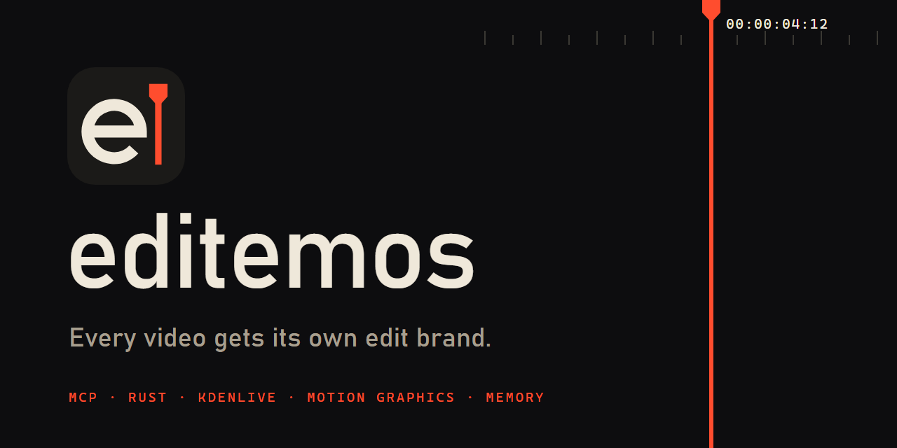
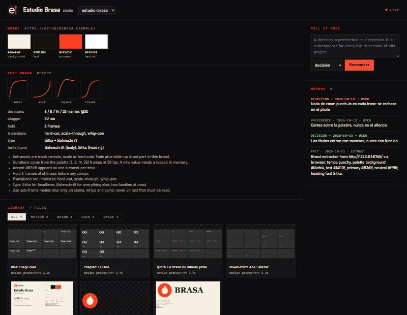
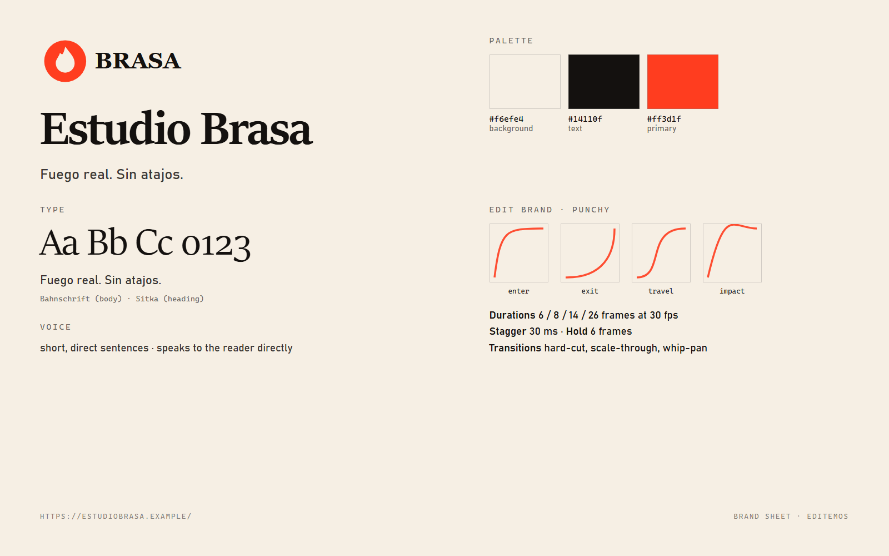

<p align="center"></p>

<p align="center"><a href="README.md">English</a></p>

**editemos** es un copiloto de edición de video. Le da a cada cliente, canal o película su propia
*marca de edición* y una memoria que vive en disco, para que una IA haga la mayor parte del
trabajo y aun así corte como *ese* proyecto y no como todos los videos hechos con IA.

Es un solo binario rápido (Rust, 8,8 MB, arranca en unos 20 ms). Corre dentro de Claude, Codex,
Gemini o cualquier agente como servidor MCP, como skill `/editemos`, como herramienta de línea de
comandos y como una página en vivo al lado de tu editor. El editor sigues siendo tú: todo lo que
hace aparece mientras lo hace, en archivos que puedes abrir, cambiar y conservar.

<p align="center"></p>

## El problema

Un editor profesional mantiene un estilo por cliente: la misma curva, el mismo lower third, el
mismo ritmo, video tras video. Los asistentes hacen lo contrario: olvidan todo entre chats, le
ponen a cada proyecto el mismo fundido con deslizamiento y escriben un script nuevo cada vez que
pides algo que ya hicieron.

| | Sin editemos | Con editemos |
| --- | --- | --- |
| **Identidad** | todo se ve como los valores por defecto del modelo | tempo, curvas, duraciones, tipografía y color derivados de la marca, únicos por proyecto |
| **Memoria** | vive en un chat que se acaba | decisiones, rechazos y gusto en archivos, cargados al empezar cada sesión |
| **Reutilización** | el mismo gráfico rehecho cinco veces | una biblioteca de motion por proyecto; pedirlo otra vez devuelve la pieza que ya existe |

## Qué trae

- **Identidad de marca desde un sitio web.** Paleta con roles, tipografías, logo, voz e imágenes
  leídos de una URL. Tres motores intercambiables: HTTP directo, el navegador de la máquina para
  sitios con JavaScript, y [Scrapling](https://github.com/D4Vinci/Scrapling) para sitios que
  rechazan clientes simples. Después genera imágenes de marca con el modelo que conectes.
- **Una marca de edición por proyecto**: tempo, cuatro curvas, paleta de duraciones, stagger,
  pausa, transiciones y tipografía que leen todos los gráficos.
- **Memoria larga y local**: JSONL con búsqueda BM25. El contexto se regenera en cada cambio y se
  escribe como `CLAUDE.md`, `AGENTS.md` y `GEMINI.md`.
- **Motion graphics sin After Effects**: escenas HTML renderizadas cuadro a cuadro con tu propio
  Chromium y codificadas con ffmpeg a ProRes 4444, QuickTime Animation o WebM, con alfa y motion
  blur real. Las escenas se pueden escribir como en Remotion (`interpolate`, `spring`,
  `Sequence`, mismos nombres y misma matemática, sin React), llevan su propio sonido sintetizado
  pegado al movimiento, y cada render se revisa en cada punto donde la escena se asienta. Un
  linter rechaza el movimiento genérico.
- **Ingeniería inversa de una referencia**: le das un video cuyo montaje quieres; mide el ritmo
  de cortes, el color y el volumen con sus pruebas, dice lo que no puede medir, y compara tu
  corte contra él rasgo por rasgo (`editemos reference`).
- **Tipos de edición abiertos (kinds)**: un tipo de edición escrito como carpeta de texto
  (reglas, valores por defecto, ejemplos y, cuando exista, un adaptador LoRA). Cada clip que
  apruebas, corriges o rechazas queda como ejemplo de su tipo, apuntando al video por link y
  sin contenerlo, y se exporta como set de entrenamiento. Cualquiera puede escribir uno y
  compartirlo: [docs/KINDS.md](docs/KINDS.md).
- **Guías de oficio incluidas**: cortes, historia en shorts, diseño sonoro, color, lenguaje de
  cámara, video generativo, motion estilo Remotion, cómo imitar una referencia.
- **Modo clips**: le pasas un stream; escucha toda la grabación cientos de veces más rápido que
  en tiempo real, elige los momentos, corta en las pausas y exporta en vertical.
- **Kdenlive**: lo abre, lee el proyecto, inserta renders en una copia versionada, saca
  borradores y aprende de lo que cambias a mano entre guardados.
- **Studio en vivo**: una página local que muestra marca, assets, renders, clips y memoria en el
  momento en que cambian.
- **Cualquier modelo**: Claude Code, Codex, Gemini CLI, DeepSeek, OpenRouter o un modelo local
  con Ollama o LM Studio, cada sesión en su propia ventana con el modelo y el esfuerzo que elijas.
- **286 skills de edición y motion** de 54 repositorios abiertos, fijados por commit y
  escaneados. Se descargan a pedido; no se redistribuyen.

<p align="center"></p>

## Instalar

```bash
cargo install --git https://github.com/PentaVM/editemos
editemos doctor
```

Opcionales, se usan solo si están: un navegador basado en Chromium, [ffmpeg](https://ffmpeg.org),
[Kdenlive](https://kdenlive.org) y Scrapling (`editemos tools install-scrapling`).

## Cinco minutos

```bash
# 1. un proyecto por cliente; lee su marca desde su sitio
editemos init "Estudio Brasa" --site https://example.com --extract
editemos brand sheet

# 2. díselo una vez
editemos memory add "Los títulos entran con máscara, nunca con fundido" --kind decision --pin
editemos memory add "Nada de zoom punch-in en cada frase" --kind rejection

# 3. un título con el movimiento propio de este proyecto, con alfa
editemos motion new title "Fuego real" --param kicker=CAP.01
editemos motion render <escena.html> --subframes 4

# 4. entra un stream, salen clips verticales
editemos clips stream.mp4 --count 5 --aspect 9:16

# 5. todo junto: Kdenlive, el studio en vivo y un agente en su propia ventana
editemos start "Estudio Brasa" --adapter claude --effort high
```

<p align="center"></p>

## De dónde sale la marca

No necesitas un sitio web ni scrapear nada.

| Tienes | Haz esto | Qué pasa |
| --- | --- | --- |
| solo una idea | dilo en el chat, o `editemos brand describe "oscuro, verde neón #19e3a1, fuente Russo One"` | colores y tipografías salen de la frase |
| valores exactos | `editemos brand set --primary "#19e3a1" --heading-font "Russo One"` | queda fijado |
| un logo o un banner | adjúntalo en el chat, o `editemos brand from-images logo.png banner.png` | paleta desde las imágenes |
| un canal o perfil | `editemos extract https://www.youtube.com/@tucanal` | avatar, banner, miniaturas, nombre y descripción; **el rojo, morado o degradado de la plataforma no es tu marca y se deja fuera** |
| un sitio web | `editemos extract https://tusitio.com` | HTTP directo, luego navegador, luego Scrapling si el sitio se niega |

En un perfil solo cuenta lo que subió el creador; las miniaturas apoyan un color pero nunca lo
eligen, y una identidad en blanco y negro se queda en blanco y negro. Después un modelo tiene la
última palabra: `editemos brand evidence` muestra cada color candidato con su origen y las
imágenes, y `editemos brand refine --adapter claude` deja que un modelo separe lo del creador de
lo de la plataforma. Dentro de Claude el propio agente mira las imágenes y corrige la marca.

Clips desde un enlace: `editemos clips <url> --section 600-1500 --layout fit --burn` baja la
grabación y sus subtítulos con yt-dlp (si está instalado), limpia los subtítulos automáticos
repetidos y los quema con la tipografía y los colores del proyecto. `--layout fit` conserva la
imagen completa sobre una copia desenfocada (gameplay); `crop` rellena desde el centro. Úsalo con
material que tengas derecho a editar.

## Usarlo desde tu agente

```bash
editemos install                          # imprime la configuración de cada cliente
editemos install claude-desktop --write   # o claude-code, codex, gemini
editemos install skill --write            # /editemos en Claude Code
```

Luego, en cualquier chat: *"editemos en Estudio Brasa: lower third para Ana, jefa de parrilla"*.
El agente carga el contexto de ese proyecto, revisa la biblioteca de motion, crea o reutiliza la
pieza, la muestra en el studio y anota lo que decidas.

```bash
editemos session --adapter codex --model gpt-5 --effort medium   # otra ventana, otro modelo
editemos chat --adapter deepseek                                 # DEEPSEEK_API_KEY
editemos chat --adapter local --model qwen2.5                    # Ollama: nada sale de la máquina
```

## Cortos, películas, clips

- **Shorts y reels**: `editemos init X --size 1080x1920`; subtítulos y títulos desde la
  biblioteca; `clips` para sacar los momentos.
- **Largos y películas**: un proyecto, una biblioteca: la tarjeta de capítulo del rollo seis es
  la misma pieza que la del uno. `editemos watch proyecto.kdenlive` anota en memoria lo que cambias.
- **Clips de un stream**: `editemos clips grabacion.mp4 --count 8 --transcript grabacion.srt`.
  Salen los clips, sus subtítulos, un manifiesto con la razón de cada elección y un EDL.

## Benchmarks

Medidos con `editemos bench` en un portátil de 6 núcleos (ocupado con otra compilación durante la
medición; detalles y la corrida en reposo en [docs/BENCHMARKS.md](docs/BENCHMARKS.md)).

| Qué | Resultado |
| --- | ---: |
| arrancar el binario | 19 ms |
| buscar en 5.000 memorias | 12 ms |
| generar el contexto | 20 ms |
| analizar la marca de una página (sin red) | 6 ms |
| captura de motion 1080p con alfa | 9,7 fps (11,3 en reposo) |
| pedir un gráfico que ya existe | 11 ms |
| escuchar una grabación de 60 minutos | 16 s (4,9 s en reposo) |

## Estado y límites

Versión 0.1, con 54 tests. Límites, dichos sin rodeos:

- Desarrollado y medido en Windows. Linux y macOS compilan y pasan la suite en CI, pero la
  detección de ventanas de Kdenlive ahí depende de `wmctrl` o AppleScript y se ha usado mucho menos.
- El modo clips puntúa por sonido (y palabras, si hay transcripción). La imagen la mira el
  agente, con `clips look` y la hoja de revisión.
- La capa Remotion trae las funciones de Remotion, no React: JSX y los paquetes `@remotion/*`
  no corren en una escena. `random(seed)` es determinista pero no da los mismos números.
- `reference` detecta solo cortes duros; los fundidos pueden quedar escondidos dentro de un plano,
  y el tempo de la música no se mide.
- Insertar un clip en un proyecto de Kdenlive (`overlay`) se verifica renderizando con melt y
  sigue marcado como experimental.
- `editemos session` abre la ventana, pero no la coloca en un monitor concreto.
- No es un plugin dentro de Kdenlive (no existe API para eso): trabaja al lado, con archivos, y
  nunca modifica tu proyecto original.

## Licencia

MIT o Apache-2.0, a elección. Los skills de terceros conservan su licencia y no se
redistribuyen; ver [NOTICE](NOTICE).
