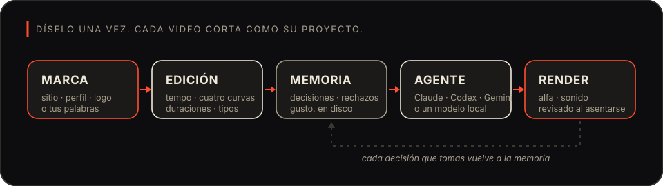
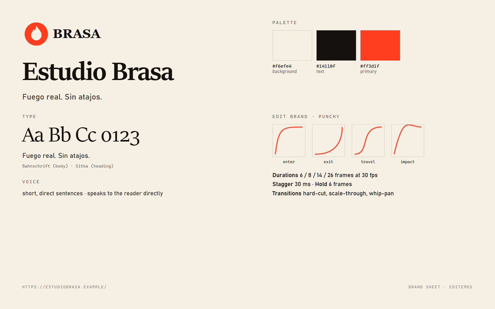
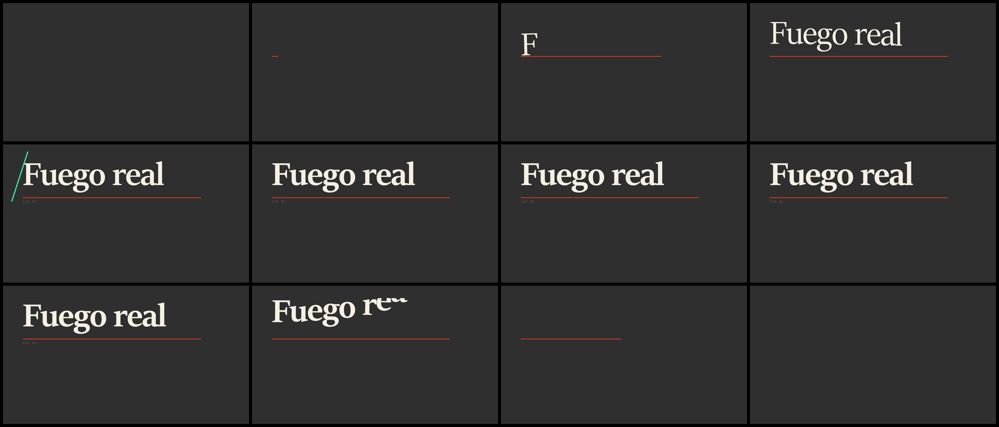
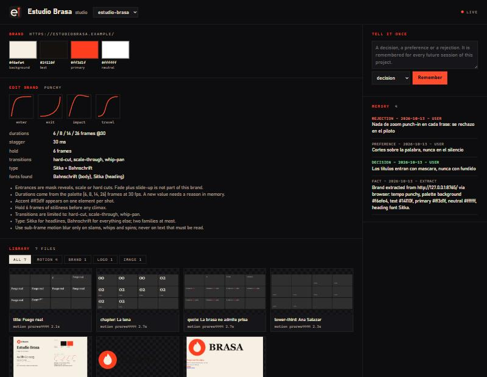
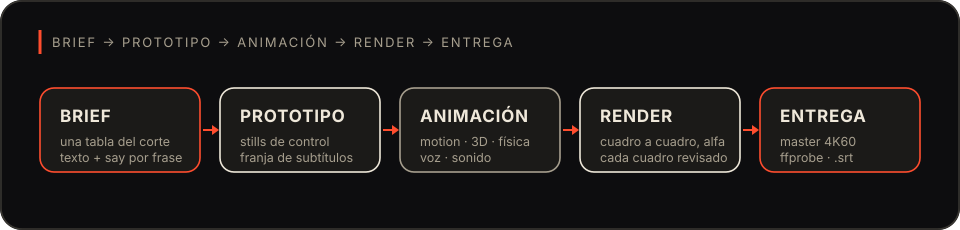

<div align="center">

[English](README.md) · **Español**

<br>


# editemos

### Cada video con su propia marca de edición.

Un copiloto de edición de video que recuerda cómo corta, se mueve y suena cada proyecto,<br>
para que una IA haga la mayor parte del trabajo y el resultado siga pareciendo de *ese* proyecto.

<br>

[](https://github.com/PentaVM/editemos/actions/workflows/ci.yml)


[](#licencia)

<br>


</div>

---

## ¿Qué es editemos?

Un editor profesional mantiene un estilo por cliente: la misma curva, el mismo lower third, el
mismo ritmo, video tras video. Los asistentes de IA hacen lo contrario: olvidan todo entre chats,
le ponen a cada proyecto el mismo fundido con deslizamiento y escriben un script nuevo cada vez
que pides algo que ya hicieron.

**editemos** le da a cada cliente, canal o película su propia **marca de edición** y una
**memoria que vive en disco**. Es un solo binario rápido (Rust, 8,8 MB, arranca en unos 20 ms)
que corre dentro de Claude, Codex, Gemini o un modelo local como servidor MCP, como skill
`/editemos`, como herramienta de línea de comandos y como una página en vivo al lado de tu
editor. El editor sigues siendo tú: todo lo que hace aparece mientras lo hace, en archivos que
puedes abrir, cambiar y conservar.

<div align="center">

</div>

| | Sin editemos | Con editemos |
| --- | --- | --- |
| **Identidad** | todo se ve como los valores por defecto del modelo | tempo, curvas, duraciones, tipografía y color derivados de la marca, únicos por proyecto |
| **Memoria** | vive en un chat que se acaba | decisiones, rechazos y gusto en archivos, cargados al empezar cada sesión |
| **Reutilización** | el mismo gráfico rehecho cinco veces | una biblioteca de motion por proyecto; pedirlo otra vez devuelve la pieza que ya existe |

## Míralo

**Una marca en una página.** Leída desde un sitio, un canal, un logo o una frase, con cada color
ligado a su origen.

<div align="center">

</div>

**Motion revisado, no supuesto.** Cada render devuelve una imagen por cada momento en que la
escena se asienta, revisada en busca de texto fuera de cuadro, encimado, demasiado chico o con
poco contraste.

<div align="center">

</div>

**El studio en vivo.** Marca, assets, renders, clips y memoria en el momento en que cambian.

<div align="center">

</div>

## Qué puedes hacer hoy

| | |
| --- | --- |
| 🎨 **Marca** | Desde un sitio, un perfil de YouTube / Instagram / TikTok / Twitch, un logo o lo que digas en el chat. Los colores de la plataforma quedan fuera; un modelo tiene la última palabra sobre qué es del creador. |
| 🎚️ **Marca de edición** | Un conjunto determinista de tokens de movimiento por proyecto: tempo, cuatro curvas, paleta de duraciones, stagger, pausa, transiciones y tipografía. Todos los gráficos la leen. |
| 🧠 **Memoria** | JSONL con búsqueda BM25, escrita como `CLAUDE.md`, `AGENTS.md` y `GEMINI.md`, para que cualquier agente empiece donde terminó la sesión anterior. |
| ✨ **Motion graphics** | Escenas HTML renderizadas cuadro a cuadro con tu propio Chromium a ProRes 4444, QuickTime Animation o WebM con alfa y motion blur real. Escritas como en Remotion, con su propio sonido sintetizado. Un linter rechaza el movimiento genérico. |
| ✂️ **Clips** | Le pasas un stream: lo escucha cientos de veces más rápido que en tiempo real, arma historias con gancho y remate, corta en las pausas, subtitula palabra por palabra y entrega al volumen de cada plataforma. |
| 🎬 **Videos pitch y demos** | Un tipo `product-pitch` y guías sacadas de dos producciones terminadas: una sola tabla del corte, grabaciones reales, voz con pronunciación, cada cuadro revisado. |
| 📦 **Entrega** | `editemos deliver`: un solo escalado lanczos, subtítulos dibujados a la resolución de salida, volumen ajustado y un master para YouTube 4K / 1080p / vertical comprobado con ffprobe. |
| 🔍 **Referencias** | Le das un video que quieres imitar: mide ritmo de cortes, color y volumen con sus pruebas, y compara tu corte rasgo por rasgo. |
| 🎞️ **Kdenlive** | Lo abre, lee el proyecto, inserta renders en una copia versionada, saca borradores y aprende de lo que cambias a mano. |
| 📚 **Oficio** | 15 guías incluidas (cortes, historia, sonido, color, cámara, 3D, voz, subtítulos, entrega...) y 286 skills de edición y motion de 54 repositorios abiertos, fijados y escaneados. |
| 🤖 **Cualquier modelo** | Claude Code, Codex, Gemini CLI, DeepSeek, OpenRouter, u Ollama / LM Studio, cada sesión en su ventana con su modelo y su esfuerzo. |

## Pruébalo

```bash
cargo install --git https://github.com/PentaVM/editemos
editemos doctor                           # qué tiene esta máquina
```

o baja un binario desde [Releases](https://github.com/PentaVM/editemos/releases). Opcionales,
cada uno se usa solo si está: un navegador basado en Chromium (motion, sitios con JavaScript),
[ffmpeg](https://ffmpeg.org) y ffprobe (codificar, clips, entrega), [Kdenlive](https://kdenlive.org)
(la línea de tiempo), Scrapling (`editemos tools install-scrapling`) y whisper.cpp
(`editemos tools install-whisper`).

**Cinco minutos:**

```bash
# 1. un proyecto por cliente; lee su marca desde su sitio
editemos init "Estudio Brasa" --site https://example.com --extract
editemos brand sheet

# 2. díselo una vez
editemos memory add "Los títulos entran con máscara, nunca con fundido" --kind decision --pin
editemos memory add "Nada de zoom punch-in en cada frase" --kind rejection

# 3. un título con el movimiento propio de este proyecto, con alfa
editemos motion new title "Fuego real" --param kicker=CAP.01
editemos motion render <escena.html> --subframes 4

# 4. entra un stream, salen clips verticales
editemos clips stream.mp4 --count 5 --aspect 9:16

# 5. todo junto: Kdenlive, el studio en vivo y un agente en su propia ventana
editemos start "Estudio Brasa" --adapter claude --effort high

# 6. el corte terminado, como master 4K60 para YouTube, verificado y con subtítulos nítidos
editemos deliver corte.mov --preset youtube-4k --subtitles corte.srt --loudness -16
```

**Desde tu agente:**

```bash
editemos install claude-code --write      # o claude-desktop, codex, gemini
editemos install skill --write            # /editemos en Claude Code
```

Luego, en cualquier chat: *"editemos en Estudio Brasa: lower third para Ana, jefa de parrilla"*.
El agente carga el contexto de ese proyecto, revisa la biblioteca de motion, crea o reutiliza la
pieza, la muestra en el studio y anota lo que decidas.

## Videos pitch y demos

<div align="center">

</div>

Un video de producto narrado (pitch de hackathon, lanzamiento, demo) es corto y denso, y lo que
falla casi nunca es la idea: un título que sigue en pantalla cuando su plano ya terminó, un
subtítulo encima de los botones de la app, una palabra mal pronunciada, una captura que da
tirones, un render que nadie puede rehacer la noche antes de la entrega. La guía `pitch-video` y
el tipo `product-pitch` traen las reglas de dos producciones terminadas (once escenas de Blender
con una web dentro de sus pantallas; la demo de una app de escritorio con voz sintética,
entregada en 4K60):

- **Una sola tabla del corte** que leen el render, las pantallas, la voz, los subtítulos, la
  exportación y el FCPXML del editor. Un tiempo escrito en dos scripts es un tiempo que va a
  estar mal.
- **Cada frase dos veces:** `text` para el subtítulo y `say` para cómo se pronuncia ("RTX 3070"
  se dice "R T X thirty seventy"). Cada frase dice algo concreto que se ve en ese momento; si la
  voz ya lo dice, el título sobra.
- **La pantalla se diseña antes que los gráficos:** franja de subtítulos reservada, títulos que
  coinciden con el narrador arriba a la izquierda, overlays que terminan con fundido en vez de
  cruzar el corte siguiente.
- **La app real, bien grabada:** modo demo determinista, el commit exacto que se presenta,
  captura cuadro a cuadro para webs, medir cuántas veces por segundo cambia la pantalla antes de
  grabar una app de escritorio, y `mpdecimate` + `minterpolate` si no llega a 60 fps.
- **Voz y subtítulos:** una frase por pedido con sus vecinas como contexto, cada frase revisada con
  faster-whisper, subtítulos con el texto del guion y los tiempos del ASR, 2 líneas de 42
  caracteres, caja suave sobre fondos cargados y un `.srt` aparte.
- **Cada cuadro revisado** en busca de capas que se tocan o caen sobre texto de la interfaz, hojas
  de contacto cada medio segundo, zoom solo donde el script marca.
- **Entregado y verificado:** armado en 1080p60, escalado a 3840x2160 con subtítulos dibujados a
  4K, −16 LUFS, comprobado con ffprobe, y un script que lo rearma sin APIs de pago.

```bash
editemos init "Lanzamiento" --size 1920x1080 --fps 60
editemos kinds use product-pitch
editemos skills read pitch-video
editemos deliver corte-1080p60.mov --preset youtube-4k --subtitles subtitulos.ass --loudness -16
```

## El stack abierto

Animación. Física. 3D. Sonido. Entrega. Veinte proyectos abiertos y cómo encaja cada uno en una
escena que editemos renderiza cuadro a cuadro. editemos no incluye ninguno; la guía
`open-source-stack` da la receta de cada uno: detener su reloj, dibujar el cuadro `n` solo a
partir de `n`, precalcular la física desde el cuadro 0, guardar la librería junto a la escena.

| | Herramienta | Para qué |
| --- | --- | --- |
| 01 | [Remotion](https://github.com/remotion-dev/remotion) | motor de video en React; su API ya está en cada escena, sin React |
| 02 | [HyperFrames](https://github.com/heygen-com/hyperframes) | render de HTML a video; sus skills están en el catálogo |
| 03 | [Anime.js](https://github.com/juliangarnier/anime) | coreografía con líneas de tiempo, posicionada por cuadro |
| 04 | [React Spring](https://github.com/pmndrs/react-spring) | animación con resortes; `spring()` integrado usa la misma física |
| 05 | [PixiJS](https://github.com/pixijs/pixijs) | gráficos 2D por GPU |
| 06 | [p5.js](https://github.com/processing/p5.js) | visuales generativos |
| 07 | [Paper.js](https://github.com/paperjs/paper.js) | trazados vectoriales |
| 08 | [Matter.js](https://github.com/liabru/matter-js) | física 2D, precalculada |
| 09 | [Three.js](https://github.com/mrdoob/three.js) | escenas 3D, con alfa |
| 10 | [Rapier](https://github.com/dimforge/rapier) | colisiones 3D, deterministas |
| 11 | [OGL](https://github.com/oframe/ogl) | shaders a medida |
| 12 | [tsParticles](https://github.com/tsparticles/tsparticles) | partículas (para prototipos; horneadas para el final) |
| 13 | [glTF Transform](https://github.com/donmccurdy/glTF-Transform) | optimizar assets 3D |
| 14 | [GL Transitions](https://github.com/gl-transitions/gl-transitions) | transiciones por shader, movidas con `interpolate` |
| 15 | [OBS Studio](https://github.com/obsproject/obs-studio) | captura de pantalla |
| 16 | [Chatterbox](https://github.com/resemble-ai/chatterbox) | locuciones en tu propia máquina |
| 17 | [Tone.js](https://github.com/Tonejs/Tone.js) | sintetizadores y efectos, renderizados offline al sonido de la escena |
| 18 | [faster-whisper](https://github.com/SYSTRAN/faster-whisper) | transcripción con tiempos por palabra para subtítulos y revisar la voz |
| 19 | [OpenCut](https://github.com/OpenCut-app/OpenCut) | edición en línea de tiempo |
| 20 | [FFmpeg](https://github.com/FFmpeg/FFmpeg) | codificación y entrega, debajo de cada render |

<div align="center"><b>Brief → prototipo → animación → render → entrega.</b></div>

## Más a fondo

<details>
<summary><b>🎨 De dónde sale la marca</b></summary>

<br>

No necesitas un sitio web ni scrapear nada.

| Tienes | Haz esto | Qué pasa |
| --- | --- | --- |
| solo una idea | dilo en el chat, o `editemos brand describe "oscuro, verde neón #19e3a1, fuente Russo One"` | colores y tipografías salen de la frase |
| valores exactos | `editemos brand set --primary "#19e3a1" --heading-font "Russo One"` | queda fijado |
| un logo o un banner | adjúntalo en el chat, o `editemos brand from-images logo.png banner.png` | paleta desde las imágenes |
| un canal o perfil | `editemos extract https://www.youtube.com/@tucanal` | avatar, banner, miniaturas, nombre y descripción; **el rojo, morado o degradado de la plataforma no es tu marca y se deja fuera** |
| un sitio web | `editemos extract https://tusitio.com` | HTTP directo, luego navegador, luego [Scrapling](https://github.com/D4Vinci/Scrapling) si el sitio se niega |

Un perfil es el caso difícil: la página está pintada con los colores de la plataforma, las
miniaturas están llenas de gameplay y la identidad del creador puede ser tres píxeles de un
avatar. Por eso solo cuenta lo que subió el creador, las miniaturas apoyan un color pero nunca lo
eligen, y una identidad en blanco y negro se queda en blanco y negro. Después un modelo tiene la
última palabra, porque es una cuestión de criterio:

```bash
editemos brand evidence                  # cada color candidato, su origen y las imágenes
editemos brand refine --adapter claude   # un modelo mira y separa al creador de la plataforma
```

Dentro de Claude o cualquier cliente MCP lo hace el propio agente: `editemos_brand
action=evidence` devuelve las imágenes, las mira y corrige la marca con `action=set`.

</details>

<details>
<summary><b>🤖 Usarlo desde tu agente: herramientas, formas y modelos</b></summary>

<br>

`editemos serve` es un servidor MCP por stdio. `editemos install` imprime la configuración de cada
cliente, o la escribe (guarda una copia de respaldo):

```json
{ "mcpServers": { "editemos": { "command": "editemos", "args": ["serve"] } } }
```

| Herramienta | Qué hace |
| --- | --- |
| `editemos_context` | marca, marca de edición, decisiones, rechazos, assets, biblioteca de motion |
| `editemos_project` | listar, crear, cambiar |
| `editemos_extract` · `editemos_brand` | leer un sitio como marca; derivar, fijar, dibujar la hoja |
| `editemos_memory_add` · `_search` · `_manage` | recordar, buscar, olvidar, compactar |
| `editemos_assets` · `editemos_generate` | catálogo; imágenes de marca con cualquier adaptador |
| `editemos_motion` | plantillas, crear, biblioteca, lint, render, póster |
| `editemos_clips` | los mejores momentos de una grabación larga, cortados y encuadrados |
| `editemos_deliver` | master final para una plataforma, subtítulos a la resolución de salida, comprobado con ffprobe |
| `editemos_reference` | medir un montaje que quieres imitar y comparar tu corte |
| `editemos_kinds` · `editemos_dataset` · `editemos_fonts` | tipos de edición, ejemplos de entrenamiento, tipografías |
| `editemos_kdenlive` | estado, inspeccionar, diff, overlay, borrador, aprender |
| `editemos_studio` · `editemos_session` | página en vivo; un agente en su propia ventana |
| `editemos_skills` · `editemos_delegate` · `editemos_doctor` | skills y guías; pasarle una tarea a otro agente; entorno |

| Forma | Para | Cómo |
| --- | --- | --- |
| **Servidor MCP** | cualquier chat, cualquier agente | `editemos serve` |
| **Skill** | un comando en Claude Code | `editemos install skill --write`, luego `/editemos` |
| **Herramienta** | scripts, CI, tus propias herramientas | la línea de comandos `editemos`; todo acepta `--json` |
| **App al lado del editor** | mirar y dirigir | `editemos studio`, `editemos start` |

```bash
editemos session --adapter claude --model opus --effort high
editemos session --adapter codex  --model gpt-5 --effort medium
editemos chat    --adapter deepseek                # DEEPSEEK_API_KEY
editemos chat    --adapter local --model qwen2.5   # Ollama: sin clave, nada sale de la máquina
```

`session` abre una terminal nueva en la carpeta del proyecto con su contexto ya cargado. `chat`
es un agente integrado para cualquier endpoint compatible con OpenAI, con las mismas
herramientas. Agrega los tuyos en `~/.editemos/adapters.toml`.

No es un plugin dentro de Kdenlive (no existe API para eso): trabaja al lado, con archivos, y
nunca modifica tu proyecto original.

</details>

<details>
<summary><b>🎚️ La marca de edición</b></summary>

<br>

Se deriva de la marca y del nombre del proyecto: es estable dentro de un proyecto y distinta entre
proyectos. Todas las plantillas la leen; nada fija una duración ni una curva a mano.

| Token | Ejemplo | Qué significa |
| --- | --- | --- |
| `tempo` | `punchy` | tranquilo, parejo o enérgico, según el contraste, la saturación y la voz de la marca |
| `easings` | `enter [0.13, 1.02, 0.24, 0.99]` | cuatro curvas propias: entrada, salida, viaje, impacto |
| `durations` | `6 / 8 / 14 / 26` | las únicas duraciones permitidas, en cuadros a 30 fps |
| `stagger_ms`, `hold_frames` | `30`, `6` | ritmo entre elementos; quietud antes del clímax |
| `transitions` | `hard-cut, scale-through, whip-pan` | tres como máximo, elegidas una vez |
| `type_tokens`, `colors` | `Sitka` + `Bahnschrift` | tipografías de la marca y roles de color de los overlays |

Cuando la ajustes a mano, fíjala: `editemos brand lock`.

</details>

<details>
<summary><b>✨ Motion graphics: plantillas, linter, Remotion, sonido, revisión</b></summary>

<br>

Seis plantillas (`title`, `lower-third`, `quote`, `chapter`, `callout`, `caption`) y cualquier
escena HTML propia que llame a `Motion.mount(timeline)`. El linter lee las animaciones que la
escena declara de verdad:

| Código | Marca |
| --- | --- |
| `GENERIC_EASE`, `FEW_EASES` | curvas de fábrica; una sola curva para todo |
| `UNIFORM_DUR`, `START_ZERO` | todo dura lo mismo; todo empieza a la vez |
| `FADE_SLIDE_DEFAULT`, `FADE_ONLY` | el fundido con deslizamiento que trae cada herramienta |
| `BOUNCY_EASE`, `DEFAULT_FONT`, `TOO_MANY_FONTS` | rebote y elástico; fuentes de sistema; más de dos familias |

Una excepción deliberada se declara en la escena, con su razón:
`Motion.allow('FADE_ONLY', 'fantasma del plano anterior')`. Las piezas renderizadas quedan en la
biblioteca del proyecto y se ofrecen otra vez:

```text
$ editemos motion new lower-third "Ana Salazar"     -> scene: .../lower-third-544d6ebe.html
$ editemos motion new lower-third "Ana Salazar"     -> reused: true (mismo archivo, nada rehecho)
```

**Escrito como Remotion, renderizado aquí.** Los modelos ya saben escribir Remotion. Las mismas
funciones existen en cada escena, con los nombres y la matemática de Remotion (el resorte es la
solución cerrada del oscilador amortiguado; los tests lo comparan con una integración numérica
independiente):

```html
<script>
const { interpolate, spring, Easing, Sequence, Sfx } = Remotion;
Motion.composition({ durationInFrames: 90, fps: 30, render(frame) {
  const s = spring({ frame, fps: 30, config: { damping: 14 } });
  title.style.transform = `scale(${s})`;
  Sequence({ from: 40 }, (f) => {
    Sfx({ kind: 'whoosh' });
    bar.style.clipPath = `inset(0 ${interpolate(f, [0, 12], [100, 0], { easing: Easing.bezier(0.16, 1, 0.3, 1), extrapolateRight: 'clamp' })}% 0 0)`;
  });
} });
</script>
```

**Sonido que se mueve con el movimiento.** `sfx: 'whoosh'` en una animación, `Sfx({ kind })`
dentro de un `Sequence`, `Motion.sfx(segundos, kind)` en cualquier parte, `Motion.beat(n, bpm)`
para una grilla musical. Click, tick, pop, whoosh, thud, boom, riser, hit, type, glitch y shimmer
se sintetizan al sample exacto (o se mezcla un audio que pongas) y van dentro del render. Mueves
la animación y su sonido se mueve con ella.

**Cada render se revisa.** Además de la hoja de contacto, un render devuelve una imagen por cada
momento en que la escena se asienta, revisada en busca de texto cortado por el borde, fuera del
margen seguro del 5 %, encimado, demasiado chico para un teléfono o con poco contraste. El
agente mira, corrige la escena y vuelve a renderizar.

</details>

<details>
<summary><b>✂️ Clips y clips con historia: editados, no solo recortados</b></summary>

<br>

```bash
editemos clips grabacion.mp4 --count 8 --transcript grabacion.srt   # la pasada rápida
editemos clips <url> --section 600-1500 --layout fit --burn         # directo desde un link (yt-dlp)
editemos clips transcript grabacion.mp4          # las palabras con sus tiempos, para planear
editemos clips story grabacion.mp4 --adapter claude --count 3 --seconds 60   # lo planea un modelo
editemos clips build grabacion.mp4 --spec-file plan.json                    # o arma tu propio plan
```

Un clip que la gente termina de ver tiene gancho en los dos primeros segundos, se salta lo
aburrido, da contexto cuando hace falta y tiene un final. Eso es criterio de editor, así que **un
modelo (o tú) decide; editemos construye.** El plan es un JSON pequeño:

```json
{ "clips": [ {
  "title": "Retó al tipo equivocado",
  "end": "punchline",
  "segments": [
    { "start": 40.9, "end": 47.4, "why": "hook" },
    { "start": 20.5, "end": 35.3, "label": "Cómo empezó" },
    { "start": 241.7, "end": 250.5, "why": "payoff" }
  ],
  "context": [ { "query": "new feature", "label": "Duelo de honor: 1v1 al tóxico", "before_segment": 1 } ]
} ] }
```

- **Los segmentos se reproducen en el orden en que los escribes**, así el planteo del remate
  puede venir de diez minutos antes y el gancho puede ser la mejor frase, no la primera.
- **El contexto** se encuentra por lo que se dijo y se muestra desaturado con tu etiqueta.
- **Las pausas se quitan** dentro de cada segmento; **los subtítulos salen del audio del propio
  clip**, transcrito en tu máquina con [whisper.cpp](https://github.com/ggml-org/whisper.cpp),
  una palabra encendida a la vez.
- **Cuando nadie habla** (un partido, un torneo), `clips events` encuentra qué pasó por el
  sonido, `clips look` muestra una grilla de cuadros con sus tiempos, y
  `clips score --region x,y,w,h` encuentra cada gol por el marcador.
- **El corte se revisa antes de salir:** una hoja muestra lo que quedó fuera a cada lado de cada
  segmento; los bordes se ajustan a los cambios de plano; los saltos llevan un zoom con motion
  blur y un whoosh; los impactos, un punch-in, una sacudida, un destello y un golpe. Cada clip se
  entrega a −14 LUFS con picos bajo −1,5 dBFS.

</details>

<details>
<summary><b>🗂️ Tipos de edición, y datos a los que cualquiera puede sumar</b></summary>

<br>

Un tipo de edición se escribe como **kind**: una carpeta con un `kind.toml` (qué es, las reglas
que sigue quien lo edita, valores por defecto para `clips build`) y los ejemplos de los que
aprende. editemos trae cuatro (`gameplay-highlights`, `talking-story`, `calm-documentary`,
`product-pitch`); cualquiera puede escribir uno y compartirlo con un pull request.

```bash
editemos kinds use gameplay-highlights              # este proyecto hace este tipo de edición
editemos dataset add clips/la-jugada.mp4 --verdict corrected --correction querido.json --notes "terminar después del gol"
editemos dataset export --out ./train               # cuadros + planes para un LoRA, y pares de preferencia
```

Los ejemplos apuntan a su video por link y nunca lo contienen, así que se pueden compartir.
Exportados, son un set de entrenamiento para un LoRA sobre un modelo de visión y lenguaje. Cómo
escribir, grabar, entrenar y compartir: [docs/KINDS.md](docs/KINDS.md).

</details>

<details>
<summary><b>🔍 Hazlo como este</b></summary>

<br>

```bash
editemos reference trailer.mp4 --name trailer        # o un link, con --section para una parte
editemos reference apply trailer                     # adoptar su tempo en la marca de edición
editemos reference compare trailer mi-corte.mp4      # en qué coincidimos y qué cambiar
```

`reference` mide los cortes duros y la duración de los planos, el color por plano y en total
(brillo, saturación, calidez, contraste, paleta) y el volumen. Cada número dice cómo se midió;
lo que no se puede medir queda listado para quien lea la hoja de un cuadro por plano. `compare`
responde con frases: "mediana de 3,1 s contra 1,4 s en la referencia (más lento); corta antes".

</details>

<details>
<summary><b>📦 Entrega</b></summary>

<br>

```bash
editemos deliver presets                                  # youtube-4k, youtube-1080, vertical
editemos deliver corte.mov --preset youtube-4k --subtitles corte.ass --loudness -16
```

Un solo escalado lanczos al tamaño del preset (con franjas si la forma es distinta, nunca
recortado), subtítulos dibujados después de escalar para que libass los deje nítidos a 4K, un
volumen objetivo opcional (ganancia medida y un limitador a −1,5 dBFS), x264 High con GOP de medio
segundo, dos B-frames, etiquetas bt709, AAC a 48 kHz y faststart. Después ffprobe lee el master y
cada diferencia con lo pedido (tamaño, cuadros por segundo, duración, audio, formato de píxel)
vuelve como problema. El `.srt` se copia junto al master; el original nunca se sobrescribe.

</details>

<details>
<summary><b>🔤 Tipografías, elegidas y recordadas</b></summary>

<br>

Una fuente de sistema no es una decisión de diseño. `editemos fonts` elige de un catálogo de
tipografías abiertas según lo que es la marca (un canal de gaming no recibe una serif de
biblioteca), la descarga una vez y la recuerda:

```bash
editemos fonts                                   # qué usa este proyecto y por qué, con alternativas
editemos fonts set "Russo One"                   # para este proyecto
editemos fonts reject "Bangers" --global --reason "demasiado cómica"   # nunca más, en ningún proyecto
editemos memory add "Subtítulos de dos palabras por línea" --global    # gusto tuyo, no de un cliente
```

</details>

## Por dentro

```text
 Claude · Codex · Gemini · local ─► MCP (stdio) ─┐            ┌─ tú, en una terminal
                                                 ▼            ▼
                                          src/mcp.rs ─► src/ops.rs ◄─ src/main.rs
                                                          │  entra JSON, sale JSON
     ┌──────────┬──────────┬──────────┬──────────┬────────┴─┬──────────┬──────────┬──────────┐
   store     memory     extract     brand     motion     clips     deliver   kdenlive   skills
   en disco  BM25       CDP         marca de  render     historia  ffprobe   copias     guías
             contexto   scrapling   edición   lint       volumen   masters   versión    de oficio
```

- **Un crate de Rust, un binario**, sin runtime async ni scripts de build.
- **`ops` es el producto:** la línea de comandos y el servidor MCP traducen las mismas funciones,
  así una persona y un agente obtienen siempre lo mismo.
- **La carpeta del proyecto es la memoria:** JSON, TOML y JSONL planos en
  `~/.editemos/projects/<slug>/`. Respáldala, compárala, ponla en git.
- **Las herramientas externas son opcionales y nunca vienen incluidas:** un navegador Chromium,
  ffmpeg y ffprobe, Kdenlive/melt, Scrapling, whisper.cpp. `editemos doctor` dice qué hay.

Más en [docs/ARCHITECTURE.md](docs/ARCHITECTURE.md).

<details>
<summary><b>Dónde vive cada cosa</b></summary>

<br>

```text
~/.editemos/                         EDITEMOS_HOME la mueve
  adapters.toml                      tus modelos
  skills/  skills.lock.json          skills descargados y las guías de oficio incluidas
  projects/<slug>/
    project.toml  brand.json  memory.jsonl  brand-sheet.png
    assets/        logos, imágenes, fuentes + index.json con su origen
    motion/        scenes/  renders/  library.json
    clips/         clips + manifiesto + EDL
    exports/       masters entregados y su .srt
    references/    referencias medidas (.json) y sus hojas de planos
    context/       CONTEXT.md, regenerado en cada cambio
    runs/          lanzadores de sesión y registros de tareas delegadas
```

</details>

## Benchmarks

Medidos con `editemos bench` (build release, Windows 11, un portátil de 6 núcleos ocupado con
otra compilación; la corrida en reposo y el método están en [docs/BENCHMARKS.md](docs/BENCHMARKS.md)).

| Qué | Resultado | Detalle |
| --- | ---: | --- |
| arrancar el binario | 19 ms | `editemos --version`, mediana de 10 |
| tamaño del binario | 8,8 MB | un archivo, sin runtime |
| crear un proyecto con su marca de edición | 58 ms | |
| escribir una memoria | 0,6 ms | promedio sobre 5.000 |
| buscar en la memoria | 12 ms | BM25 sobre 5.000 memorias |
| generar el contexto | 20 ms | ordenado entre 5.000 memorias |
| analizar la marca de una página | 6 ms | sin contar la red |
| captura de motion 1080p con alfa | 9,7 fps | tres ventanas del navegador (11,3 en reposo) |
| pedir un gráfico que ya existe | 11 ms | reutilizado, no rehecho |
| clips: escuchar una grabación de 60 minutos | 16 s | 226x tiempo real (736x en reposo) |
| clips: elegir los momentos | 10 ms | entre 36.000 muestras de volumen |

## Estado

Versión 0.5. 90 tests (unitarios, MCP por tuberías reales, extracción contra un sitio local, un
render cuyo alfa se decodifica y revisa, clips cuyo cuadro de salida se mide, un master 4K leído
con ffprobe, la API del studio y sus protecciones) corren en Windows, Linux y macOS en CI. Sin
rodeos:

- **Desarrollado y medido en Windows.** Linux y macOS compilan y pasan la suite en CI, pero la
  detección de ventanas de Kdenlive ahí depende de `wmctrl` o AppleScript y se ha usado mucho menos.
- **Los clips puntúan por sonido** (y palabras, si hay transcripción). La imagen la juzga el
  agente, con `clips look` y la hoja de revisión.
- **La tipografía no se puede leer de un avatar.** Tras extraer un perfil, la fuente es provisoria
  hasta que tú, o un modelo que pueda ver, nombre una.
- **Instagram y TikTok** a menudo no muestran nada a un visitante anónimo; la herramienta lo dice y
  pide la marca a mano o desde una imagen. No inicia sesión.
- **`overlay` en Kdenlive** se verifica renderizando con melt y sigue marcado como experimental.
- **La capa Remotion** trae las funciones de Remotion, no React: JSX y los paquetes `@remotion/*`
  no corren en una escena, y `random(seed)` no da los mismos números que Remotion.
- **El texto quemado necesita libass.** El ffmpeg de Homebrew en macOS no lo trae: los clips se
  cortan igual y `deliver` se niega a quemar subtítulos en vez de saltárselos en silencio.
- **`reference` detecta solo cortes duros**, y el tempo de la música no se mide.

## Seguridad

No se sube nada. Las claves vienen de variables de entorno y nunca se guardan. El studio escucha
solo en 127.0.0.1 y rechaza pedidos de otros sitios. La extracción respeta `robots.txt`. Los
skills de terceros son texto, fijado, con hash y escaneado; trátalos como datos. Los proyectos de
Kdenlive nunca se editan en el lugar. Detalles en [SECURITY.md](SECURITY.md).

## Para leer más

[Arquitectura](docs/ARCHITECTURE.md) · [Tipos de edición](docs/KINDS.md) ·
[Benchmarks](docs/BENCHMARKS.md) · [Contribuir](CONTRIBUTING.md) · [Seguridad](SECURITY.md) ·
[Catálogo de skills](skills/catalog.toml) · [Guías de oficio](assets/craft)

## Contribuir

Ver [CONTRIBUTING.md](CONTRIBUTING.md). En corto: una operación en `src/ops.rs`, expuesta en los
dos frentes, con un test que revisa el resultado y no solo el código de salida. Una guía nueva es
un Markdown en `assets/craft/`; un tipo nuevo es una carpeta en `kinds/`.

## Licencia

MIT o Apache-2.0, a elección. Los skills de terceros conservan su licencia y no se redistribuyen
aquí; ver [NOTICE](NOTICE) y [skills/catalog.toml](skills/catalog.toml).

<div align="center">

<br>


**Hecho con amor por Penta ❤️**

*Made with love by Penta ❤️*

</div>
