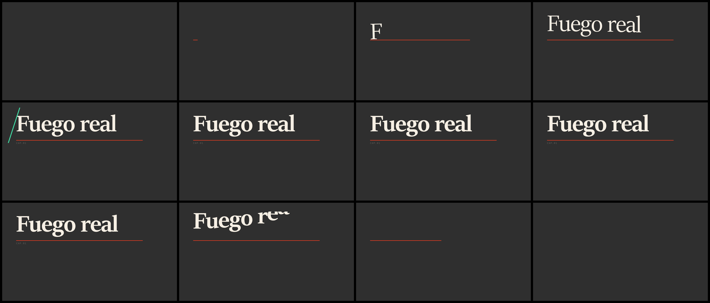

<p align="center"></p>

<p align="center">
  <a href="https://github.com/PentaVM/editemos/actions/workflows/ci.yml"></a>
  
  
  
</p>

<p align="center"><a href="README.es.md">Español</a></p>

**editemos** is a co-pilot for video editing. It gives every client, channel or film its own
*edit brand* and a memory that lives on disk, so an AI can do most of the work and still cut
like *that* project instead of like every other AI video.

It is one fast binary (Rust, 8.8 MB, starts in about 20 ms). It runs inside Claude, Codex, Gemini
or any agent as an MCP server, as a `/editemos` skill, as a command-line toolkit, and as a live
page next to your editor. You stay the editor: everything it makes shows up as it is made, in
files you can open, change and keep.

> *editemos* is Spanish for "let's edit".

<p align="center"></p>

## The problem

Professional editors keep a house style per client: the same easing, the same lower third, the
same rhythm, video after video. Assistants do the opposite. They forget everything between chats,
give every project the same fade-and-slide-up, and write a new script each time you ask for
something they already made.

editemos fixes those three things:

| | Without | With editemos |
| --- | --- | --- |
| **Identity** | every video looks like the model's defaults | tempo, curves, durations, type and colour derived from the brand, unique per project |
| **Memory** | lives in a chat that ends | decisions, rejections and taste in plain files, loaded at the start of every session |
| **Reuse** | the same graphic rebuilt five times | one motion library per project; asking again returns the piece that exists |

## What is in the box

- **Brand identity, from wherever it lives.** A website, a YouTube / Instagram / TikTok / Twitch
  profile, a logo, or simply what you say in the chat. Palette with roles, typefaces, logo and
  voice, each kept with where it came from. On a social profile the platform's own colours are
  left out and only what the creator uploaded counts. Then generate on-brand images with
  whichever model you plug in.
- **An edit brand per project.** A deterministic set of motion tokens (tempo, four easing
  curves, a duration palette, stagger, hold, transitions, type) that every graphic reads.
- **Long memory, local.** Append-only JSONL with BM25 retrieval. A context pack is regenerated
  on every change and written as `CLAUDE.md`, `AGENTS.md` and `GEMINI.md`, so any agent starts
  where the last session ended.
- **Motion graphics without After Effects.** HTML scenes rendered frame by frame through your
  own Chromium and encoded with ffmpeg to ProRes 4444, QuickTime Animation or WebM, all with
  alpha, with real sub-frame motion blur. A linter rejects generic motion.
- **Clips mode.** Hand it a stream; it listens to the whole recording hundreds of times faster
  than real time, picks the moments, cuts on pauses and exports them framed for vertical.
- **Kdenlive, hands on.** Start it, read the open project, insert renders into a versioned copy,
  render drafts, and learn from what you change by hand between saves.
- **A live studio.** A local page that shows brand, assets, renders, clips and memory the moment
  they change, and lets you tell it what to remember.
- **Any model.** Claude Code, Codex, Gemini CLI, DeepSeek, OpenRouter, or a local model through
  Ollama or LM Studio. Open a session in its own window and choose model and effort per session.
- **286 editing and motion skills** from 54 open-source repositories, pinned by commit,
  hashed and scanned for prompt injection. Downloaded on demand, never redistributed.

<p align="center"></p>

## Install

```bash
cargo install --git https://github.com/PentaVM/editemos
```

or download a binary from [Releases](https://github.com/PentaVM/editemos/releases).
Then see what your machine has:

```bash
editemos doctor
```

Optional, each used only if present: a Chromium-based browser (Edge, Chrome, Chromium, Brave) for
motion and JavaScript sites, [ffmpeg](https://ffmpeg.org) for encoding and clips,
[Kdenlive](https://kdenlive.org) for the timeline, Scrapling (`editemos tools install-scrapling`).

## Five minutes

```bash
# 1. a project per client; read its brand from its website
editemos init "Estudio Brasa" --site https://example.com --extract
editemos brand sheet                      # the identity on one page

# 2. tell it things once
editemos memory add "Titles enter through a mask, never a fade" --kind decision --pin
editemos memory add "No punch-in zoom on every sentence" --kind rejection

# 3. a title in this project's own motion, with alpha
editemos motion new title "Real fire" --param kicker=CH.01
editemos motion render <scene.html> --subframes 4

# 4. a stream in, vertical clips out
editemos clips stream.mp4 --count 5 --aspect 9:16

# 5. everything at once: Kdenlive, the live studio, an agent in its own window
editemos start "Estudio Brasa" --adapter claude --effort high
```

<p align="center"></p>

## Where the brand comes from

You do not need a website, and you do not need to scrape anything.

| You have | Do this | What happens |
| --- | --- | --- |
| nothing but an idea | just say it in the chat, or `editemos brand describe "dark, neon green #19e3a1, font Russo One"` | colours and typefaces are read out of the sentence |
| exact values | `editemos brand set --primary "#19e3a1" --heading-font "Russo One"` | stated, done |
| a logo or a banner | attach it in the chat, or `editemos brand from-images logo.png banner.png` | palette from the pictures |
| a channel or profile | `editemos extract https://www.youtube.com/@yourchannel` | avatar, banner, thumbnails, name and description; **the platform's red, purple or gradient is not your brand and is left out** |
| a website | `editemos extract https://yoursite.com` | plain HTTP, then the browser, then [Scrapling](https://github.com/D4Vinci/Scrapling) if the site refuses |

A profile is the hard case: the page is painted in the platform's colours, thumbnails are full of
game footage, and the creator's identity may be three pixels of an avatar. So the extractor reads
only what the creator uploaded, lets thumbnails support a colour but never choose it, and keeps a
black-and-white identity black and white instead of inventing a hue. Then a model gets the last
word, because this is a judgement:

```bash
editemos brand evidence                  # every candidate colour, where it came from, the pictures
editemos brand refine --adapter claude   # a model looks and separates creator from platform
```

Inside Claude or any MCP client the agent does this itself: `editemos_brand action=evidence`
returns the pictures, it looks at them, and corrects the brand with `action=set`.

## Use it from your agent

`editemos serve` is an MCP server on stdio. Print the exact configuration for your client, or
let it write the file (a backup is kept):

```bash
editemos install                          # prints every snippet
editemos install claude-desktop --write
editemos install claude-code --write
editemos install codex --write
editemos install gemini --write
editemos install skill --write            # /editemos in Claude Code
```

```json
{ "mcpServers": { "editemos": { "command": "editemos", "args": ["serve"] } } }
```

Then, in any chat: *"editemos for Estudio Brasa: lower third for Ana, chef"*. The agent loads that
project's context, checks the motion library, makes or reuses the piece, shows it in the studio
and writes down what you decide.

| Tool | What it does |
| --- | --- |
| `editemos_context` | brand, edit brand, decisions, rejections, assets, motion library |
| `editemos_project` | list, create, switch |
| `editemos_extract` · `editemos_brand` | read a website into a brand; derive, lock, draw the sheet |
| `editemos_memory_add` · `_search` · `_manage` | remember, find, forget, compact |
| `editemos_assets` · `editemos_generate` | catalogue; on-brand images through any adapter |
| `editemos_motion` | templates, new, library, lint, render, poster |
| `editemos_clips` | best moments of a long recording, cut and framed |
| `editemos_kdenlive` | status, inspect, diff, overlay, draft, learn |
| `editemos_studio` · `editemos_session` | live page; an agent in its own window |
| `editemos_skills` · `editemos_delegate` · `editemos_doctor` | skill library; hand a task to another agent; environment |

### Four ways to run it

| Form | For | How |
| --- | --- | --- |
| **MCP server** | any chat, any agent | `editemos serve` |
| **Skill** | one command in Claude Code | `editemos install skill --write`, then `/editemos` |
| **Toolkit** | scripts, CI, your own tools | the `editemos` command line; every command takes `--json` |
| **App beside the editor** | watching and steering | `editemos studio`, `editemos start` |

It is not a plugin inside Kdenlive: Kdenlive has no plugin API for this. It works beside the
editor through files and never modifies your project in place. See
[docs/ARCHITECTURE.md](docs/ARCHITECTURE.md).

### Any model, its own window

```bash
editemos session --adapter claude --model opus --effort high
editemos session --adapter codex  --model gpt-5 --effort medium
editemos session --adapter gemini
editemos chat    --adapter deepseek            # DEEPSEEK_API_KEY
editemos chat    --adapter local --model qwen2.5   # Ollama, no key, nothing leaves the machine
```

`session` opens a new terminal window in the project folder with that project's context already
in place. `chat` is a built-in agent loop for any OpenAI-compatible endpoint, with the same tools.
Add your own in `~/.editemos/adapters.toml`.

## The edit brand

Derived from the brand and the project's name, so it is stable for a project and different
between projects. Every template reads it; nothing hard-codes a duration or a curve.

| Token | Example | Meaning |
| --- | --- | --- |
| `tempo` | `punchy` | calm, steady or punchy, from the brand's contrast, saturation and voice |
| `easings` | `enter [0.13, 1.02, 0.24, 0.99]` | four signature cubic-beziers: enter, exit, travel, impact |
| `durations` | `6 / 8 / 14 / 26` | the only durations allowed, in frames at 30 fps |
| `stagger_ms`, `hold_frames` | `30`, `6` | rhythm between elements; stillness before a climax |
| `transitions` | `hard-cut, scale-through, whip-pan` | at most three, chosen once |
| `type_tokens`, `colors` | `Sitka` + `Bahnschrift` | brand typefaces and overlay colour roles |

Lock it once you have tuned it by hand: `editemos brand lock`.

## Motion graphics

<p align="center"></p>

Six templates (`title`, `lower-third`, `quote`, `chapter`, `callout`, `caption`) and any HTML
scene of your own that calls `Motion.mount(timeline)`. The linter reads the tweens a scene
actually declares:

| Code | Flags |
| --- | --- |
| `GENERIC_EASE`, `FEW_EASES` | stock easings; one curve for everything |
| `UNIFORM_DUR`, `START_ZERO` | every tween the same length; everything starting at once |
| `FADE_SLIDE_DEFAULT`, `FADE_ONLY` | the fade plus small slide every tool ships |
| `BOUNCY_EASE`, `DEFAULT_FONT`, `TOO_MANY_FONTS` | bounce and elastic; web-safe fonts; more than two families |

A deliberate exception is declared in the scene, with its reason: `Motion.allow('FADE_ONLY', 'ghost of the previous shot')`.

Rendered pieces are recorded in the project's motion library and offered again:

```text
$ editemos motion new lower-third "Ana Salazar"     -> scene: .../lower-third-544d6ebe.html
$ editemos motion new lower-third "Ana Salazar"     -> reused: true (same file, nothing rebuilt)
```

## Shorts, films, clips

- **Shorts and reels.** `editemos init X --size 1080x1920`; captions and titles from the
  library; `clips` to source moments.
- **Long form and films.** One project, one motion library: the chapter card in reel six is the
  same piece as in reel one. Work scene by scene in Kdenlive; `editemos watch project.kdenlive`
  writes what you change into memory.
- **Clips from a stream.** `editemos clips recording.mp4 --count 8 --transcript recording.srt`.
  You get the clips, per-clip subtitles, a JSON manifest with the reason for each pick, and an
  EDL. Disagree with a pick, edit the manifest, export again.
- **Straight from a link.** `editemos clips <url> --section 600-1500 --layout fit --burn` fetches
  the recording and its captions with [yt-dlp](https://github.com/yt-dlp/yt-dlp) (if installed),
  de-duplicates rolling auto-captions, and burns them in the project's own typeface and colours.
  `--layout fit` keeps the whole picture over a blurred copy of itself, which is what gameplay and
  screen recordings need; `crop` fills the frame from the centre. Use it on footage you have the
  right to edit.

## Benchmarks

Measured with `editemos bench` (release build, Windows 11, a 6-core laptop). Run it yourself;
it prints this table. The laptop was busy with an unrelated compile during this run; the quiet
run and the method are in [docs/BENCHMARKS.md](docs/BENCHMARKS.md).

| What | Result | Detail |
| --- | ---: | --- |
| start the binary | 19 ms | `editemos --version`, median of 10 |
| binary size | 8.8 MB | one file, no runtime |
| create a project with its edit brand | 58 ms | |
| write a memory | 0.6 ms | average over 5,000 |
| search memory | 12 ms | BM25 over 5,000 memories |
| build the context pack | 20 ms | ranked out of 5,000 memories |
| brand analysis of a page | 6 ms | network excluded |
| motion capture, 1080p with alpha | 9.7 fps | three browser windows (11.3 fps when the machine is idle) |
| ask for a graphic that exists | 11 ms | reused, not rebuilt |
| clips: listen to a 60-minute recording | 16 s | 226x real time (736x when idle) |
| clips: choose the moments | 10 ms | from 36,000 loudness samples |

## Where things live

```text
~/.editemos/                         EDITEMOS_HOME moves it
  adapters.toml                      your models
  skills/  skills.lock.json          downloaded skills, pinned and hashed
  projects/<slug>/
    project.toml  brand.json  memory.jsonl  brand-sheet.png
    assets/        logos, images, fonts + index.json with provenance
    motion/        scenes/  renders/  library.json
    clips/         clips + manifest + EDL
    context/       CONTEXT.md, regenerated on every change
    runs/          session launchers and delegated-run logs
```

Plain JSON, TOML and JSONL. Back it up, diff it, put it in git.

## Safety

Nothing is uploaded. Keys come from environment variables and are never stored. The studio
listens on 127.0.0.1 only and refuses other sites' requests. Extraction obeys `robots.txt`.
Third-party skills are text, pinned, hashed and scanned; treat them as data. Kdenlive projects
are never edited in place. Details in [SECURITY.md](SECURITY.md).

## Status

Version 0.1. The test suite (54 tests: unit, MCP over real pipes, extraction against a local
site, a render whose alpha is decoded and checked, clips whose output frame is measured, the
studio's API and guards) runs on Windows, Linux and macOS in CI.

Known limits, stated plainly:

- Developed and benchmarked on Windows. Linux and macOS build and pass the suite in CI, but
  window detection for Kdenlive there depends on `wmctrl` or AppleScript, and has seen far less use.
- Clips mode ranks moments by sound (and words, with a transcript). It does not watch the picture.
- Typefaces cannot be read from an avatar. After a profile extraction the typeface is a fallback
  until you, or a model that can see, name one.
- Instagram and TikTok often show nothing to an anonymous visitor. When that happens the tool
  says so and asks for the brand by hand or from a picture; it does not log in.
- Inserting a clip into a Kdenlive project (`overlay`) is verified by rendering the result with
  melt, and is still marked experimental; opening the copy in the GUI is the final check.
- `editemos session` opens the window; it does not place it on a particular monitor.

## Contributing

See [CONTRIBUTING.md](CONTRIBUTING.md). The short version: one operation in `src/ops.rs`, exposed
in both front ends, with a test that checks the output rather than the exit code.

## License

MIT or Apache-2.0, at your option. Third-party skills keep their own licences and are not
redistributed here; see [NOTICE](NOTICE) and [skills/catalog.toml](skills/catalog.toml).
