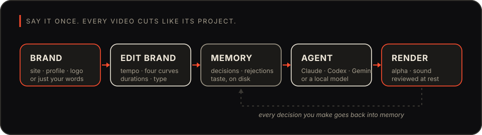
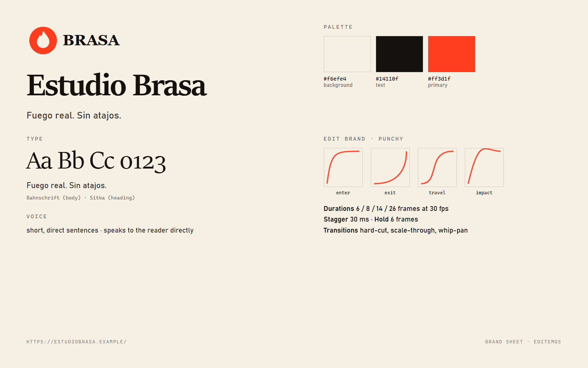
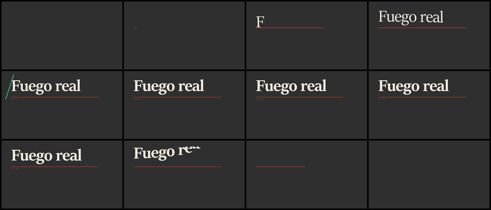
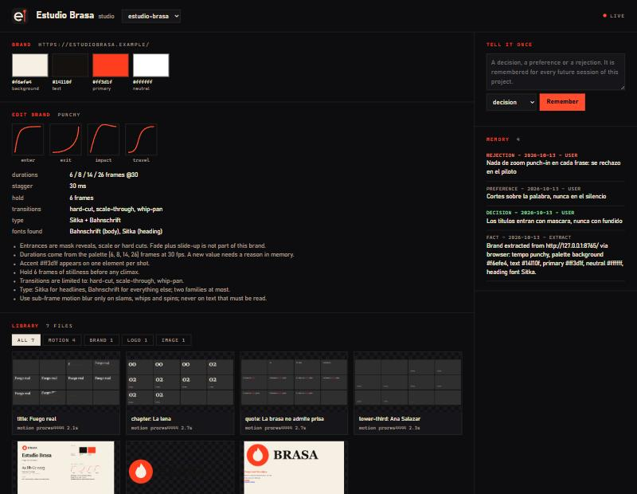
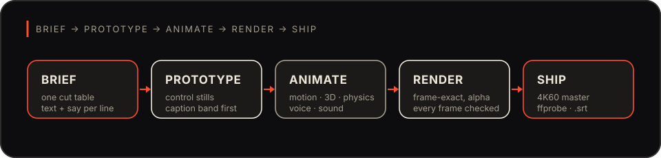

<div align="center">

**English** · [Español](README.es.md)

<br>


# editemos

### Every video gets its own edit brand.

A co-pilot for video editing that remembers how each project cuts, moves and sounds,<br>
so an AI does most of the work and the result still looks like *that* project.

<br>

[](https://github.com/PentaVM/editemos/actions/workflows/ci.yml)


[](#license)

<br>


<sub><i>editemos</i> is Spanish for "let's edit".</sub>

</div>

---

## What is editemos?

Professional editors keep a house style per client: the same easing, the same lower third, the
same rhythm, video after video. AI assistants do the opposite. They forget everything between
chats, give every project the same fade-and-slide-up, and write a new script each time you ask
for something they already made.

**editemos** gives every client, channel or film its own **edit brand** and a **memory that
lives on disk**. It is one fast binary (Rust, 8.8 MB, starts in about 20 ms) that runs inside
Claude, Codex, Gemini or a local model as an MCP server, as a `/editemos` skill, as a
command-line toolkit, and as a live page next to your editor. You stay the editor: everything it
makes shows up as it is made, in files you can open, change and keep.

<div align="center">

</div>

| | Without | With editemos |
| --- | --- | --- |
| **Identity** | every video looks like the model's defaults | tempo, curves, durations, type and colour derived from the brand, unique per project |
| **Memory** | lives in a chat that ends | decisions, rejections and taste in plain files, loaded at the start of every session |
| **Reuse** | the same graphic rebuilt five times | one motion library per project; asking again returns the piece that exists |

## See it

**A brand, on one page.** Read from a website, a channel, a logo or a sentence, with every colour
traced to where it came from.

<div align="center">

</div>

**Motion that is reviewed, not assumed.** Every render returns a still for each moment the scene
comes to rest, checked for text off the frame, overlapping, too small or low in contrast.

<div align="center">

</div>

**The live studio.** Brand, assets, renders, clips and memory, the moment they change.

<div align="center">

</div>

## What you can do today

| | |
| --- | --- |
| 🎨 **Brand** | From a website, a YouTube / Instagram / TikTok / Twitch profile, a logo, or what you say in the chat. The platform's own colours are left out; a model gets the last word on what belongs to the creator. |
| 🎚️ **Edit brand** | A deterministic set of motion tokens per project: tempo, four easing curves, a duration palette, stagger, hold, transitions, type. Every graphic reads it. |
| 🧠 **Memory** | Append-only JSONL with BM25 retrieval, written as `CLAUDE.md`, `AGENTS.md` and `GEMINI.md`, so any agent starts where the last session ended. |
| ✨ **Motion graphics** | HTML scenes rendered frame by frame through your own Chromium to ProRes 4444, QuickTime Animation or WebM with alpha and real motion blur. Written the Remotion way, with their own synthesised sound. A linter rejects generic motion. |
| ✂️ **Clips** | Hand it a stream: it listens hundreds of times faster than real time, plans stories with a hook and a payoff, cuts on pauses, captions word by word and delivers at platform loudness. |
| 🎬 **Pitch and demo videos** | A `product-pitch` kind and guides from two finished productions: one cut table, real screen recordings, voice with pronunciation, every frame checked. |
| 📦 **Delivery** | `editemos deliver`: one lanczos scale, subtitles drawn at the output size, loudness set, a YouTube 4K / 1080p / vertical master read back with ffprobe. |
| 🔍 **References** | Point at a video you want to imitate: cut rhythm, grade and loudness measured with evidence, and your cut compared trait by trait. |
| 🎞️ **Kdenlive** | Start it, read the open project, insert renders into a versioned copy, render drafts, and learn from what you change by hand. |
| 📚 **Craft** | 15 built-in guides (cutting, story, sound, colour, camera, 3D, voice, captions, delivery...) and 286 editing and motion skills from 54 open-source repositories, pinned and scanned. |
| 🤖 **Any model** | Claude Code, Codex, Gemini CLI, DeepSeek, OpenRouter, or Ollama / LM Studio, each session in its own window with its own model and effort. |

## Try it

```bash
cargo install --git https://github.com/PentaVM/editemos
editemos doctor                           # what this machine has
```

or download a binary from [Releases](https://github.com/PentaVM/editemos/releases). Optional,
each used only if present: a Chromium-based browser (motion, JavaScript sites),
[ffmpeg](https://ffmpeg.org) and ffprobe (encoding, clips, delivery), [Kdenlive](https://kdenlive.org)
(the timeline), Scrapling (`editemos tools install-scrapling`), whisper.cpp
(`editemos tools install-whisper`).

**Five minutes:**

```bash
# 1. a project per client; read its brand from its website
editemos init "Estudio Brasa" --site https://example.com --extract
editemos brand sheet

# 2. tell it things once
editemos memory add "Titles enter through a mask, never a fade" --kind decision --pin
editemos memory add "No punch-in zoom on every sentence" --kind rejection

# 3. a title in this project's own motion, with alpha
editemos motion new title "Real fire" --param kicker=CH.01
editemos motion render <scene.html> --subframes 4

# 4. a stream in, vertical clips out
editemos clips stream.mp4 --count 5 --aspect 9:16

# 5. everything at once: Kdenlive, the live studio, an agent in its own window
editemos start "Estudio Brasa" --adapter claude --effort high

# 6. the finished cut, as a checked 4K60 YouTube master with sharp subtitles
editemos deliver cut.mov --preset youtube-4k --subtitles cut.srt --loudness -16
```

**From your agent:**

```bash
editemos install claude-code --write      # or claude-desktop, codex, gemini
editemos install skill --write            # /editemos in Claude Code
```

Then, in any chat: *"editemos for Estudio Brasa: lower third for Ana, chef"*. The agent loads
that project's context, checks the motion library, makes or reuses the piece, shows it in the
studio and writes down what you decide.

## Pitch and demo videos

<div align="center">

</div>

A narrated product video (a hackathon pitch, a launch, a demo) is short and dense, and what goes
wrong is rarely the idea: a title still on screen after its shot ended, a caption on top of the
app's own buttons, a word the voice mispronounces, a capture that stutters, a render nobody can
rebuild the night before the deadline. The `pitch-video` guide and the `product-pitch` kind carry
the rules from two finished productions (eleven Blender scenes with a web app on screens inside
them; a desktop-app demo with synthetic narration delivered at 4K60):

- **One cut table** that render, screen inserts, voice, captions, export and the editor's FCPXML
  all read. A time written in two scripts is a time that will be wrong.
- **Each voice line twice:** `text` for the caption, `say` for how it is spoken ("RTX 3070" is
  said "R T X thirty seventy"). Each line says one concrete thing that is on screen then; a title
  that repeats the voice is left out.
- **The frame is designed before any graphic:** a reserved caption band, titles that coincide with
  narration top left, overlays that end with a fade instead of crossing the next cut.
- **The real app, recorded right:** a deterministic demo mode, the exact commit presented,
  frame-by-frame capture for web apps, the real update rate measured before a desktop take, and
  `mpdecimate` + `minterpolate` when it falls short of 60 fps.
- **Voice and captions:** one sentence per synthesis request with its neighbours as context, every
  line checked by faster-whisper, captions from the corrected script with ASR timings, two lines of
  42 characters, a soft box over busy backgrounds, a separate `.srt`.
- **Every frame checked** for layers touching or landing on interface text, contact sheets every
  half second, close looks only where the script points.
- **Delivered and verified:** built at 1080p60, scaled to 3840x2160 with subtitles drawn at 4K,
  -16 LUFS, checked with ffprobe, and a rebuild script that works without paid APIs.

```bash
editemos init "Launch" --size 1920x1080 --fps 60
editemos kinds use product-pitch
editemos skills read pitch-video
editemos deliver cut-1080p60.mov --preset youtube-4k --subtitles captions.ass --loudness -16
```

## The open-source stack

Animation. Physics. 3D. Sound. Delivery. Twenty open-source projects, and how each one fits a
scene that editemos renders frame by frame. editemos bundles none of them; the
`open-source-stack` guide gives the recipe for each: stop its clock, draw frame `n` from `n`
alone, precompute physics from frame 0, vendor the library next to the scene.

| | Tool | For |
| --- | --- | --- |
| 01 | [Remotion](https://github.com/remotion-dev/remotion) | React video engine; its API is built into every scene, without React |
| 02 | [HyperFrames](https://github.com/heygen-com/hyperframes) | HTML-to-video renderer; its skills are in the catalogue |
| 03 | [Anime.js](https://github.com/juliangarnier/anime) | timeline choreography, seeked per frame |
| 04 | [React Spring](https://github.com/pmndrs/react-spring) | spring animation; the built-in `spring()` is the same physics |
| 05 | [PixiJS](https://github.com/pixijs/pixijs) | GPU 2D graphics |
| 06 | [p5.js](https://github.com/processing/p5.js) | generative visuals |
| 07 | [Paper.js](https://github.com/paperjs/paper.js) | vector paths |
| 08 | [Matter.js](https://github.com/liabru/matter-js) | 2D physics, precomputed |
| 09 | [Three.js](https://github.com/mrdoob/three.js) | 3D scenes, with alpha |
| 10 | [Rapier](https://github.com/dimforge/rapier) | 3D collisions, deterministic |
| 11 | [OGL](https://github.com/oframe/ogl) | custom shaders |
| 12 | [tsParticles](https://github.com/tsparticles/tsparticles) | particle effects (prototypes; baked for the final) |
| 13 | [glTF Transform](https://github.com/donmccurdy/glTF-Transform) | 3D asset optimisation |
| 14 | [GL Transitions](https://github.com/gl-transitions/gl-transitions) | shader transitions driven by `interpolate` |
| 15 | [OBS Studio](https://github.com/obsproject/obs-studio) | screen capture |
| 16 | [Chatterbox](https://github.com/resemble-ai/chatterbox) | voice-overs on your own machine |
| 17 | [Tone.js](https://github.com/Tonejs/Tone.js) | synths and effects, rendered offline into a scene's sound |
| 18 | [faster-whisper](https://github.com/SYSTRAN/faster-whisper) | word-timed transcription for captions and voice checks |
| 19 | [OpenCut](https://github.com/OpenCut-app/OpenCut) | timeline editing |
| 20 | [FFmpeg](https://github.com/FFmpeg/FFmpeg) | encoding and delivery, under every render |

<div align="center"><b>Brief → prototype → animate → render → ship.</b></div>

## Go deeper

<details>
<summary><b>🎨 Where the brand comes from</b></summary>

<br>

You do not need a website, and you do not need to scrape anything.

| You have | Do this | What happens |
| --- | --- | --- |
| nothing but an idea | just say it in the chat, or `editemos brand describe "dark, neon green #19e3a1, font Russo One"` | colours and typefaces are read out of the sentence |
| exact values | `editemos brand set --primary "#19e3a1" --heading-font "Russo One"` | stated, done |
| a logo or a banner | attach it in the chat, or `editemos brand from-images logo.png banner.png` | palette from the pictures |
| a channel or profile | `editemos extract https://www.youtube.com/@yourchannel` | avatar, banner, thumbnails, name and description; **the platform's red, purple or gradient is not your brand and is left out** |
| a website | `editemos extract https://yoursite.com` | plain HTTP, then the browser, then [Scrapling](https://github.com/D4Vinci/Scrapling) if the site refuses |

A profile is the hard case: the page is painted in the platform's colours, thumbnails are full of
game footage, and the creator's identity may be three pixels of an avatar. So the extractor reads
only what the creator uploaded, lets thumbnails support a colour but never choose it, and keeps a
black-and-white identity black and white instead of inventing a hue. Then a model gets the last
word, because this is a judgement:

```bash
editemos brand evidence                  # every candidate colour, where it came from, the pictures
editemos brand refine --adapter claude   # a model looks and separates creator from platform
```

Inside Claude or any MCP client the agent does this itself: `editemos_brand action=evidence`
returns the pictures, it looks at them, and corrects the brand with `action=set`.

</details>

<details>
<summary><b>🤖 Use it from your agent: tools, forms and models</b></summary>

<br>

`editemos serve` is an MCP server on stdio. `editemos install` prints the configuration for every
client, or writes it (a backup is kept):

```json
{ "mcpServers": { "editemos": { "command": "editemos", "args": ["serve"] } } }
```

| Tool | What it does |
| --- | --- |
| `editemos_context` | brand, edit brand, decisions, rejections, assets, motion library |
| `editemos_project` | list, create, switch |
| `editemos_extract` · `editemos_brand` | read a website into a brand; derive, lock, draw the sheet |
| `editemos_memory_add` · `_search` · `_manage` | remember, find, forget, compact |
| `editemos_assets` · `editemos_generate` | catalogue; on-brand images through any adapter |
| `editemos_motion` | templates, new, library, lint, render, poster |
| `editemos_clips` | best moments of a long recording, cut and framed |
| `editemos_deliver` | final master for a platform, subtitles at output size, checked with ffprobe |
| `editemos_reference` | measure an edit to imitate, compare your cut to it |
| `editemos_kinds` · `editemos_dataset` · `editemos_fonts` | edit kinds, training examples, typefaces |
| `editemos_kdenlive` | status, inspect, diff, overlay, draft, learn |
| `editemos_studio` · `editemos_session` | live page; an agent in its own window |
| `editemos_skills` · `editemos_delegate` · `editemos_doctor` | skills and craft guides; hand a task to another agent; environment |

| Form | For | How |
| --- | --- | --- |
| **MCP server** | any chat, any agent | `editemos serve` |
| **Skill** | one command in Claude Code | `editemos install skill --write`, then `/editemos` |
| **Toolkit** | scripts, CI, your own tools | the `editemos` command line; every command takes `--json` |
| **App beside the editor** | watching and steering | `editemos studio`, `editemos start` |

```bash
editemos session --adapter claude --model opus --effort high
editemos session --adapter codex  --model gpt-5 --effort medium
editemos chat    --adapter deepseek            # DEEPSEEK_API_KEY
editemos chat    --adapter local --model qwen2.5   # Ollama, no key, nothing leaves the machine
```

`session` opens a new terminal window in the project folder with that project's context already
in place. `chat` is a built-in agent loop for any OpenAI-compatible endpoint, with the same tools.
Add your own in `~/.editemos/adapters.toml`.

It is not a plugin inside Kdenlive: Kdenlive has no plugin API for this. It works beside the
editor through files and never modifies your project in place.

</details>

<details>
<summary><b>🎚️ The edit brand</b></summary>

<br>

Derived from the brand and the project's name, so it is stable for a project and different
between projects. Every template reads it; nothing hard-codes a duration or a curve.

| Token | Example | Meaning |
| --- | --- | --- |
| `tempo` | `punchy` | calm, steady or punchy, from the brand's contrast, saturation and voice |
| `easings` | `enter [0.13, 1.02, 0.24, 0.99]` | four signature cubic-beziers: enter, exit, travel, impact |
| `durations` | `6 / 8 / 14 / 26` | the only durations allowed, in frames at 30 fps |
| `stagger_ms`, `hold_frames` | `30`, `6` | rhythm between elements; stillness before a climax |
| `transitions` | `hard-cut, scale-through, whip-pan` | at most three, chosen once |
| `type_tokens`, `colors` | `Sitka` + `Bahnschrift` | brand typefaces and overlay colour roles |

Lock it once you have tuned it by hand: `editemos brand lock`.

</details>

<details>
<summary><b>✨ Motion graphics: templates, linter, Remotion, sound, review</b></summary>

<br>

Six templates (`title`, `lower-third`, `quote`, `chapter`, `callout`, `caption`) and any HTML
scene of your own that calls `Motion.mount(timeline)`. The linter reads the tweens a scene
actually declares:

| Code | Flags |
| --- | --- |
| `GENERIC_EASE`, `FEW_EASES` | stock easings; one curve for everything |
| `UNIFORM_DUR`, `START_ZERO` | every tween the same length; everything starting at once |
| `FADE_SLIDE_DEFAULT`, `FADE_ONLY` | the fade plus small slide every tool ships |
| `BOUNCY_EASE`, `DEFAULT_FONT`, `TOO_MANY_FONTS` | bounce and elastic; web-safe fonts; more than two families |

A deliberate exception is declared in the scene, with its reason: `Motion.allow('FADE_ONLY', 'ghost of the previous shot')`.
Rendered pieces are recorded in the project's motion library and offered again:

```text
$ editemos motion new lower-third "Ana Salazar"     -> scene: .../lower-third-544d6ebe.html
$ editemos motion new lower-third "Ana Salazar"     -> reused: true (same file, nothing rebuilt)
```

**Written like Remotion, rendered here.** Models already know how to write Remotion. The same
functions exist in every scene, with Remotion's names and maths (the spring is the
damped-oscillator closed form; the test suite checks it against an independent numerical
integration):

```html
<script>
const { interpolate, spring, Easing, Sequence, Sfx } = Remotion;
Motion.composition({ durationInFrames: 90, fps: 30, render(frame) {
  const s = spring({ frame, fps: 30, config: { damping: 14 } });
  title.style.transform = `scale(${s})`;
  Sequence({ from: 40 }, (f) => {
    Sfx({ kind: 'whoosh' });
    bar.style.clipPath = `inset(0 ${interpolate(f, [0, 12], [100, 0], { easing: Easing.bezier(0.16, 1, 0.3, 1), extrapolateRight: 'clamp' })}% 0 0)`;
  });
} });
</script>
```

**Sound that moves with the motion.** `sfx: 'whoosh'` on a tween, `Sfx({ kind })` inside a
`Sequence`, `Motion.sfx(seconds, kind)` anywhere, `Motion.beat(n, bpm)` for a music grid. Click,
tick, pop, whoosh, thud, boom, riser, hit, type, glitch and shimmer are synthesised sample-exact
(or an audio file you place is mixed) and muxed into the render. Move a tween and its sound
moves with it.

**Every render is reviewed.** Besides the contact sheet, a render returns one still for each
moment the scene comes to rest, checked for text cut by the frame edge, outside the 5% safe
margin, overlapping, too small for a phone, or with low contrast. The agent looks, fixes the
scene, renders again.

</details>

<details>
<summary><b>✂️ Clips and story clips: edited, not just cut out</b></summary>

<br>

```bash
editemos clips recording.mp4 --count 8 --transcript recording.srt   # the quick pass
editemos clips <url> --section 600-1500 --layout fit --burn         # straight from a link (yt-dlp)
editemos clips transcript recording.mp4          # the words with their times, to plan from
editemos clips story recording.mp4 --adapter claude --count 3 --seconds 60   # a model plans it
editemos clips build recording.mp4 --spec-file plan.json                    # or build your own plan
```

A clip people finish has a hook in the first two seconds, the boring parts skipped, context when
it is needed, and an ending. That is an editor's judgement, so **a model (or you) decides;
editemos builds.** The plan is a small JSON document:

```json
{ "clips": [ {
  "title": "He challenged the wrong guy",
  "end": "punchline",
  "segments": [
    { "start": 40.9, "end": 47.4, "why": "hook" },
    { "start": 20.5, "end": 35.3, "label": "How it started" },
    { "start": 241.7, "end": 250.5, "why": "payoff" }
  ],
  "context": [ { "query": "new feature", "label": "Honor duel: 1v1 the toxic one", "before_segment": 1 } ]
} ] }
```

- **Segments play in the order you list them**, so the payoff's setup can come from ten minutes
  earlier and the hook can be the best line, not the first one.
- **Context** is found by what was said and flashed, desaturated, with your label on it.
- **Pauses are removed** inside segments; **captions come from the clip's own audio**,
  transcribed on your machine with [whisper.cpp](https://github.com/ggml-org/whisper.cpp), one
  word lit at a time.
- **When nobody is talking** (a match, a tournament), `clips events` finds what happened by
  sound, `clips look` shows a grid of frames with their times, and `clips score --region x,y,w,h`
  finds every goal by the scoreboard.
- **The cut is checked before it ships:** a review sheet shows what was left out on each side of
  every segment; edges snap onto shot changes; jumps get a zoom-through with motion blur and a
  whoosh; impacts get a punch-in, a shake, a flash and a hit. Every clip is delivered at -14 LUFS
  with peaks under -1.5 dBFS.

</details>

<details>
<summary><b>🗂️ Edit kinds, and data anyone can add to</b></summary>

<br>

A type of edit is written down as an **edit kind**: a folder with a `kind.toml` (what it is, the
rules an editor of it follows, defaults for `clips build`) and the examples it learns from. Four
ship with editemos (`gameplay-highlights`, `talking-story`, `calm-documentary`, `product-pitch`);
anyone can write one and share it by pull request.

```bash
editemos kinds use gameplay-highlights              # this project makes this kind of edit
editemos dataset add clips/the-play.mp4 --verdict corrected --correction wanted.json --notes "end after the goal"
editemos dataset export --out ./train               # frames + plans for a LoRA, and preference pairs
```

Examples point at their footage by link and never contain it, so they can be shared. Exported,
they are a training set for a LoRA on a vision-language model. How to write, record, train and
share: [docs/KINDS.md](docs/KINDS.md).

</details>

<details>
<summary><b>🔍 Make it like this one</b></summary>

<br>

```bash
editemos reference trailer.mp4 --name trailer        # or a link, with --section for part of it
editemos reference apply trailer                     # adopt its tempo in the edit brand
editemos reference compare trailer my-cut.mp4        # where we match it and what to change
```

`reference` measures the hard cuts and shot lengths, the grade per shot and overall
(brightness, saturation, warmth, contrast, palette) and the loudness. Each number says how it
was measured; what cannot be measured is listed for whoever reads the sheet of one frame per
shot. `compare` answers in sentences: "median 3.1 s against 1.4 s in the reference (slower); cut
sooner".

</details>

<details>
<summary><b>📦 Delivery</b></summary>

<br>

```bash
editemos deliver presets                                  # youtube-4k, youtube-1080, vertical
editemos deliver cut.mov --preset youtube-4k --subtitles cut.ass --loudness -16
```

One lanczos scale to the preset's size (letterboxed if the shape differs, never cropped),
subtitles drawn after the scale so libass renders them sharp at 4K, an optional loudness target
(a measured gain and a limiter at -1.5 dBFS), x264 High with a GOP of half a second, two
B-frames, bt709 tags, AAC at 48 kHz and faststart. Then ffprobe reads the master and every
difference from what was asked (size, frame rate, duration, audio, pixel format) comes back as a
problem. The `.srt` is copied next to the master; the source is never overwritten.

</details>

<details>
<summary><b>🔤 Typefaces, chosen and remembered</b></summary>

<br>

A system fallback is not a design decision. `editemos fonts` picks from a catalogue of open
display faces by what the brand is (a gaming channel does not get a bookish serif), downloads it
once, and remembers:

```bash
editemos fonts                                   # what this project uses and why, with alternatives
editemos fonts set "Russo One"                   # for this project
editemos fonts reject "Bangers" --global --reason "too comic"   # never again, in any project
editemos memory add "Captions two words per line" --global      # taste that is yours, not a client's
```

</details>

## Under the hood

```text
 Claude · Codex · Gemini · local ─► MCP (stdio) ─┐            ┌─ you, in a terminal
                                                 ▼            ▼
                                          src/mcp.rs ─► src/ops.rs ◄─ src/main.rs
                                                          │  JSON in, JSON out
     ┌──────────┬──────────┬──────────┬──────────┬────────┴─┬──────────┬──────────┬──────────┐
   store     memory     extract     brand     motion     clips     deliver   kdenlive   skills
   on disk   BM25       CDP         edit      render     story     ffprobe   versioned  craft
             context    scrapling   brand     lint       loudness  masters   copies     guides
```

- **One Rust crate, one binary**, no async runtime, no build scripts.
- **`ops` is the product:** the command line and the MCP server are translations of the same
  functions, so a person and an agent always get the same behaviour.
- **The project folder is the memory:** plain JSON, TOML and JSONL under
  `~/.editemos/projects/<slug>/`. Back it up, diff it, put it in git.
- **External tools are optional and never bundled:** a Chromium browser, ffmpeg and ffprobe,
  Kdenlive/melt, Scrapling, whisper.cpp. `editemos doctor` says what is present.

More in [docs/ARCHITECTURE.md](docs/ARCHITECTURE.md).

<details>
<summary><b>Where things live</b></summary>

<br>

```text
~/.editemos/                         EDITEMOS_HOME moves it
  adapters.toml                      your models
  skills/  skills.lock.json          downloaded skills and the built-in craft guides
  projects/<slug>/
    project.toml  brand.json  memory.jsonl  brand-sheet.png
    assets/        logos, images, fonts + index.json with provenance
    motion/        scenes/  renders/  library.json
    clips/         clips + manifest + EDL
    exports/       delivered masters and their .srt
    references/    measured reference edits (.json) and their shot sheets
    context/       CONTEXT.md, regenerated on every change
    runs/          session launchers and delegated-run logs
```

</details>

## Benchmarks

Measured with `editemos bench` (release build, Windows 11, a 6-core laptop, busy with an
unrelated compile; the quiet run and the method are in [docs/BENCHMARKS.md](docs/BENCHMARKS.md)).

| What | Result | Detail |
| --- | ---: | --- |
| start the binary | 19 ms | `editemos --version`, median of 10 |
| binary size | 8.8 MB | one file, no runtime |
| create a project with its edit brand | 58 ms | |
| write a memory | 0.6 ms | average over 5,000 |
| search memory | 12 ms | BM25 over 5,000 memories |
| build the context pack | 20 ms | ranked out of 5,000 memories |
| brand analysis of a page | 6 ms | network excluded |
| motion capture, 1080p with alpha | 9.7 fps | three browser windows (11.3 fps when idle) |
| ask for a graphic that exists | 11 ms | reused, not rebuilt |
| clips: listen to a 60-minute recording | 16 s | 226x real time (736x when idle) |
| clips: choose the moments | 10 ms | from 36,000 loudness samples |

## Status

Version 0.5. 90 tests (unit, MCP over real pipes, extraction against a local site, a render whose
alpha is decoded and checked, clips whose output frame is measured, a 4K master read back with
ffprobe, the studio's API and guards) run on Windows, Linux and macOS in CI. Honestly:

- **Developed and benchmarked on Windows.** Linux and macOS build and pass the suite in CI, but
  Kdenlive window detection there depends on `wmctrl` or AppleScript and has seen far less use.
- **Clips rank moments by sound** (and words, with a transcript). The picture is judged by the
  agent, through `clips look` and the review sheet.
- **Typefaces cannot be read from an avatar.** After a profile extraction the typeface is a
  fallback until you, or a model that can see, name one.
- **Instagram and TikTok** often show nothing to an anonymous visitor; the tool says so and asks
  for the brand by hand or from a picture. It does not log in.
- **Kdenlive `overlay`** is verified by rendering with melt and is still marked experimental.
- **The Remotion layer** has Remotion's functions, not React: JSX and `@remotion/*` packages do not
  run in a scene, and `random(seed)` does not return Remotion's numbers.
- **Burned-in text needs libass.** Homebrew's ffmpeg on macOS has none: clips are still cut there
  and `deliver` refuses to burn subtitles instead of silently skipping them.
- **`reference` detects hard cuts only**, and music tempo is not measured.

## Safety

Nothing is uploaded. Keys come from environment variables and are never stored. The studio
listens on 127.0.0.1 only and refuses other sites' requests. Extraction obeys `robots.txt`.
Third-party skills are text, pinned, hashed and scanned; treat them as data. Kdenlive projects
are never edited in place. Details in [SECURITY.md](SECURITY.md).

## Read more

[Architecture](docs/ARCHITECTURE.md) · [Edit kinds](docs/KINDS.md) ·
[Benchmarks](docs/BENCHMARKS.md) · [Contributing](CONTRIBUTING.md) · [Security](SECURITY.md) ·
[Skill catalogue](skills/catalog.toml) · [Craft guides](assets/craft)

## Contributing

See [CONTRIBUTING.md](CONTRIBUTING.md). The short version: one operation in `src/ops.rs`, exposed
in both front ends, with a test that checks the output rather than the exit code. A new craft
guide is a Markdown file in `assets/craft/`; a new kind is a folder in `kinds/`.

## License

MIT or Apache-2.0, at your option. Third-party skills keep their own licences and are not
redistributed here; see [NOTICE](NOTICE) and [skills/catalog.toml](skills/catalog.toml).

<div align="center">

<br>


**Made with love by Penta ❤️**

*Hecho con amor por Penta ❤️*

</div>
